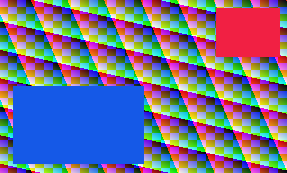
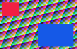
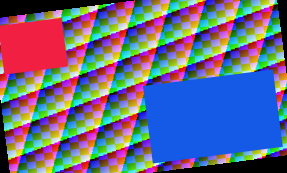
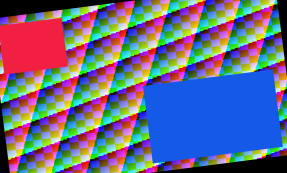

# 第五课：TorchVision 与 OpenCV 同款增强对比

## 【本节核心知识点】

用同一张图片把两条增强路线的颜色、尺寸、参数和随机来源逐项对齐，再用真实全图比较区分“输入没对齐”“随机参数不同”和“实现本身有差异”。

## 【核心概念讲解】

### 1. 前情提要：本课从哪里接上

第四课已教师协助修正后结课：整数抽样上界、旋转中心、模糊参数需要核对，保存后读回及重建同种子验证也已补齐。那次证明修正版产物通过，不等于你已能脱离参考独立组装。本课在对照中再练一次这些检查，不额外要求先复述才能开始。单元测试①保留待安排，按你本次决定先开第五课。

### 2. “同款”指同一类任务，不预设所有像素都相同

先建立一张 comparison（对比）表：

| 对比项 | TorchVision本课PIL路线 | OpenCV本课数组路线 | 比较前要做什么 |
|---|---|---|---|
| 输入 | Pillow读取后明确为RGB | 默认彩色读取为BGR | 用同一个无损文件，再统一为RGB |
| 表示 | PIL图片；转NumPy后同样是HWC | NumPy的HWC数组 | 本课不转张量，不提前引入CHW |
| 尺寸 | PIL的size先宽高；F.resize尺寸先高宽 | shape先高宽通道；resize尺寸先宽高 | 用非正方形目标检查顺序 |
| 水平翻转 | F.hflip，确定执行 | flip方向码1，确定执行 | 统一颜色后比较全部像素 |
| 缩放 | PIL双线性缩小及其抗锯齿 | OpenCV INTER_LINEAR | 同名插值不保证相同像素，记录差异 |
| 旋转 | 给定角度，默认图像中心，双线性、补黑、不扩画布 | 同角度，显式像素坐标中点，双线性、补黑、原画布 | 先共用参数；后端坐标、插值和边缘采样仍可能不同 |
| 随机源 | 当前RandomRotation抽角度使用PyTorch | 本课自己用NumPy生成器抽角度 | 相同种子整数不等于两库参数同步 |

本课的“后端”是实际完成计算的实现：TorchVision接收PIL图片时，本例的变换交由Pillow处理；换成张量输入会走另一条实现路线，不能把本课观察无条件推广过去。[S1][S2]

**本课反例提醒**：错：“同一整数种子，两库角度就相同”；错：“两图shape一样，说明内容正确”；错：“像素不同，说明一定有一套库写错”。先检查参数和颜色，再解释差异。

### 3. 为何先比较翻转，再比较缩放与旋转

水平翻转只是重新安排已有像素的位置。它适合当作检查链：读取同一PNG→两路线各自翻转→统一RGB→整图比较。若这一步不同，先查颜色或方向，不急着研究插值。

缩放和任意角度旋转通常需要插值，即根据邻近像素估计新位置的值。抗锯齿指缩小时抑制细小花纹产生的假条纹；PIL双线性缩放会做这类处理，OpenCV本例的INTER_LINEAR没有被我们配置为完全相同的滤波路线。[S1][S3] 本课故意记录差异，不做跨库严格等价复刻，也不凭差异更小判断质量。

PIL默认图像中心与OpenCV像素坐标中点采用不同坐标约定。不能看到宽高除二和减一除二两个写法，就直接宣布两图必定偏移半像素；要结合坐标约定与实测内容判断。本例只把角度、画布、插值类别及补黑方向控制住，不把观测到的旋转差异全部归因给某一个因素。[S2][S3]

### 4. 两种“相同”分开验

- **同一路线可重放**：重新设好对应随机源，保持调用顺序和范围，再跑后得到相同参数与文件。
- **两条路线相同**：同一次比较中，颜色和形状对齐后，比较两库结果。这可能为False，即使两条路线各自完全可重放。

`F`是functional（函数接口）的别名，`F.rotate`只执行你给定的角度；`RandomRotation.get_params`只抽角度，不处理图片。先抽一次共享角度，再交给两库，能排除两次独立抽样带来的差异；本课另设一个实验，展示两套随机源分别重设后各自复现，但相同整数种子仍不对齐。[S4]

### 5. 差异计算先保护类型，保存后再读回

先统一RGB，再把两张uint8数组分别转为int16后相减并取绝对值。int16是可容纳负数的十六位整数，本课只装两幅八位图的分量差；不要在uint8里相减后才转换。

最大分量差表示最不同的某个颜色分量；平均分量差表示整图所有像素、所有通道的差的平均。它们不表示不同像素的个数，也不能用来给两库质量排名。打印时保留小数精度，实际变换参数不提前舍入。

保存时PIL路线保留RGB图片，OpenCV路线保留BGR数组；RGB数组只用于比较。读回每张文件，核对实际shape、dtype和全图像素，避免只验证内存、没验证落地文件。

## 【核心内置函数拆解】

这里沿用课程栏目名，主要是库函数和方法，不是Python内置函数。签名按本机BaiQing3.10AI的帮助与官方版本文档核对；方括号表示可选参数，不输入方括号。序号与演示注释对应。

### ① PIL 打开与明确RGB

- **作用**：读取一张图片，并明确后续使用红、绿、蓝的通道顺序。
- **完整语法**：`Image.open(fp, mode='r', formats=None)`；`image.convert(mode=None, matrix=None, dither=None, palette=Palette.WEB, colors=256)`。
- **关键参数**：`fp`为路径或文件对象；`convert`本课只传模式字符串`RGB`，其余参数保留默认。
- **返回值**：`open`返回PIL图片；`convert`返回转换后的图片，不是NumPy数组。
- **常见坑**：图片对象的`size`是宽、高；模式转换不会创建CHW张量，也不自动除以255。只使用已知RGB教学PNG，本课不处理EXIF方向。
- **适用场景**：在TorchVision的PIL路线中读取图片。

### ② cv2.imread

- **作用**：读取输入文件，或读回保存后的真实文件。
- **完整语法**：`cv2.imread(filename[, flags]) -> retval`。
- **关键参数**：`IMREAD_COLOR`读取BGR；`IMREAD_UNCHANGED`保留文件实际通道。
- **返回值**：成功返回图像数组，失败返回`None`。
- **常见坑**：本机中文绝对路径读取已知有问题；本课从课程工作目录使用英文相对路径。读回实际通道后再做颜色转换。
- **适用场景**：OpenCV读取，以及文件落地后的验收。

### ③ np.array

- **作用**：把PIL图片转换成可比较的NumPy数组。
- **完整语法**：`np.array(object, dtype=None, *, copy=True, order='K', subok=False, ndmin=0, like=None)`。
- **关键参数**：`object`本课是RGB的PIL图片；`dtype`省略时沿用图片所含类型。
- **返回值**：新的NumPy数组；本课是HWC顺序的RGB、uint8。
- **常见坑**：它既不交换红蓝，也不把HWC变CHW；不要把“转成数组”和“转成模型张量”混在一起。
- **适用场景**：在不引入张量训练的前提下，比较两条图像路线。

### ④ cv2.cvtColor

- **作用**：按指定转换代码改变颜色表示。
- **完整语法**：`cv2.cvtColor(src, code[, dst[, dstCn[, hint]]]) -> dst`。
- **关键参数**：`COLOR_BGR2RGB`用于比较；`COLOR_RGB2BGR`用于将RGB数组交给OpenCV保存。`hint`为当前版本可选算法提示，本课省略。
- **返回值**：转换后的新图像数组。
- **常见坑**：本课不把RGB比较数组送给按BGR约定工作的保存路径；同形状不能发现红蓝错位。
- **适用场景**：比较前统一颜色；跨库传递图片时明确颜色顺序。

### ⑤ np.array_equal

- **作用**：判断形状与全部对应元素是否完全一致。
- **完整语法**：`np.array_equal(a1, a2, equal_nan=False)`。
- **关键参数**：`a1`、`a2`本课必须是同颜色顺序的数组；`equal_nan`沿用默认。
- **返回值**：一个真假值。
- **常见坑**：结果False仅说明有分量不同，不直接说明哪条路线更好；跨库不同不等于同一路线不可重放。
- **适用场景**：检验输入颜色、翻转一致性和保存前后全图内容。

### ⑥ F.hflip

- **作用**：直接执行确定的左右翻转。
- **完整语法**：`F.hflip(img)`，其中`F`是`torchvision.transforms.functional`的别名。
- **关键参数**：`img`本课为PIL图片；没有概率参数。
- **返回值**：本课返回翻转后的PIL图片；也支持文档规定的张量输入。
- **常见坑**：它和随机水平翻转不是同一个调用层级：随机策略需要另外抽样。
- **适用场景**：排除概率干扰，用已知变换检查两条路线是否对齐。

### ⑦ cv2.flip

- **作用**：按翻转方向生成新图。
- **完整语法**：`cv2.flip(src, flipCode[, dst]) -> dst`。
- **关键参数**：`flipCode`取1为左右翻转、0为上下翻转、负数为两方向同时翻转。
- **返回值**：翻转后的数组，形状和类型不变。
- **常见坑**：0不是“不翻转”；先明确是左右还是上下，再比较全图。
- **适用场景**：与确定的水平翻转对照。

### ⑧ F.resize

- **作用**：把图片缩放到指定尺寸。
- **完整语法**：`F.resize(img, size, interpolation=InterpolationMode.BILINEAR, max_size=None, antialias=True)`。
- **关键参数**：`size`成对指定时先高后宽；单整数匹配短边并保留比例；本课使用成对尺寸。`interpolation`为双线性；`max_size`本课不用；`antialias`为抗锯齿开关。
- **返回值**：缩放后的图片，本课仍为PIL图片。
- **常见坑**：PIL输入的双线性/双三次缩放始终抗锯齿，不能用`antialias=False`要求它关闭；该开关控制的是相应张量路线。[S1]
- **适用场景**：确定尺寸对比，观察同名插值不保证跨库相同像素。

### ⑨ cv2.resize

- **作用**：将图像数组缩放到指定宽高。
- **完整语法**：`cv2.resize(src, dsize[, dst[, fx[, fy[, interpolation]]]]) -> dst`。
- **关键参数**：`dsize`先宽后高；本课显式`INTER_LINEAR`；`fx`、`fy`是替代缩放倍率，此处不用。
- **返回值**：缩放后的新数组。
- **常见坑**：不要把PIL size、TorchVision size和NumPy shape的顺序当成同一个；不能只因插值名称相近就要求全图相等。[S3]
- **适用场景**：和PIL双线性路线比较；本课观察差异，不做质量排名。

### ⑩ array.astype、np.abs与差异汇总

- **作用**：先用可容纳负数的类型相减，再统计每个颜色分量的绝对差。
- **完整语法**：`array.astype(dtype, order='K', casting='unsafe', subok=True, copy=True)`；`np.absolute(x, /, out=None, *, where=True, casting='same_kind', order='K', dtype=None, subok=True[, signature])`，`np.abs`是其别名；`array.max(axis=None, out=None, keepdims=False, initial=<no value>, where=True)`；`array.mean(axis=None, dtype=None, out=None, keepdims=False, *, where=True)`。
- **关键参数**：`dtype=np.int16`可容纳本课两幅uint8图像的正负差；汇总时不传`axis`，覆盖高、宽、全部颜色分量。`<no value>`是帮助中的未提供标记，不是实参。
- **返回值**：`astype`返回转换数组，`abs`返回逐分量绝对差，`max`和`mean`返回总体标量。
- **常见坑**：先uint8相减再取绝对值会回绕；本课“平均分量差”是所有像素全部通道差的平均，不是不同像素的数量。
- **适用场景**：报告差异大小；不把差异量误当质量指标。

### ⑪ NumPy生成器与均匀抽样

- **作用**：独立管理随机状态，抽一次共享角度。
- **完整语法**：`np.random.default_rng(seed=None)`；`rng.uniform(low=0.0, high=1.0, size=None)`。
- **关键参数**：`seed`控制初始状态；`low`、`high`为角度上下界；省略`size`每次抽一个。
- **返回值**：前者返回生成器，后者返回浮点数或数组。
- **常见坑**：浮点通常按左闭右开理解，极端舍入可能触及上端；相同种子还要同接口、同版本、同抽样顺序。计算保留原值，打印再舍入。
- **适用场景**：把“抽参数”和“执行变换”拆开，公平观察两条实现。

### ⑫ F.rotate

- **作用**：用给定角度旋转图片，不自行抽取角度。
- **完整语法**：`F.rotate(img, angle, interpolation=InterpolationMode.NEAREST, expand=False, center=None, fill=None)`。
- **关键参数**：`angle`单位为度，正角逆时针；本课显式双线性；`expand=False`保持画布；`center=None`用后端默认图像中心；`fill`为RGB补充值。[S2]
- **返回值**：旋转后的图片，本课为PIL图片。
- **常见坑**：默认插值是最近邻，需显式改为双线性；后端坐标与边缘采样规则也要考虑，不能只对齐角度就宣称两个实现完全等价。
- **适用场景**：共享抽样角度时执行TorchVision/PIL路线。

### ⑬ OpenCV旋转矩阵与执行

- **作用**：先计算坐标矩阵，再生成输出图片。
- **完整语法**：`cv2.getRotationMatrix2D(center, angle, scale) -> retval`；`cv2.warpAffine(src, M, dsize[, dst[, flags[, borderMode[, borderValue[, hint]]]]]) -> dst`。
- **关键参数**：中心先横后纵，本课为宽高各减一后的一半；倍率1；输出宽高保持原图；`INTER_LINEAR`插值、`BORDER_CONSTANT`补BGR黑色。
- **返回值**：前者返回两行三列矩阵，后者返回新图片数组。
- **常见坑**：矩阵不是图片；复制上课演示参数时必须重新核对本题合同。PIL默认中心与OpenCV像素坐标写法不同，本例不把数字坐标不相同直接判成中心偏移。[S2][S3]
- **适用场景**：执行受控的同角度OpenCV旋转。

### ⑭ torch.manual_seed

- **作用**：重设PyTorch随机数状态。
- **完整语法**：`torch.manual_seed(seed)`。
- **关键参数**：`seed`为整数；本课在每次抽样前重设同一个值来重放。
- **返回值**：PyTorch的Generator对象；本课只利用其设置状态的副作用。
- **常见坑**：不会替你重建NumPy default_rng；本课验证当前TorchVision传统transforms抽角度路径，不推广到所有库和所有版本。[S4]
- **适用场景**：对TorchVision抽样来源做可观察的控制。

### ⑮ RandomRotation.get_params

- **作用**：只抽取随机旋转需要的角度。
- **完整语法**：`transforms.RandomRotation.get_params(degrees)`。
- **关键参数**：`degrees`为最小、最大角度组成的序列。
- **返回值**：一个浮点角度，不是图片，也不是旋转矩阵。
- **常见坑**：与`F.rotate`配合才真正旋转；当前已验证版本的该方法使用PyTorch随机源，相同整数种子不保证和NumPy得到同角度。[S4]
- **适用场景**：看清随机增强封装里的“抽参数”阶段。

### ⑯ 两条保存路线

- **作用**：分别把PIL/RGB图片和OpenCV/BGR数组保存为PNG。
- **完整语法**：`image.save(fp, format=None, **params)`；`cv2.imwrite(filename, img[, params]) -> retval`。
- **关键参数**：PIL图片用`.save`；OpenCV数组用`imwrite`；本课由`.png`扩展名决定无损格式；必须提前建父目录。
- **返回值**：PIL的`save`成功返回None，失败抛异常；OpenCV写入成功返回True，也可能抛异常。
- **常见坑**：不能拿PIL的None当作保存失败；也不能只看文件存在，必须读回对照保存前内存结果。
- **适用场景**：同时验证处理结果与文件产物一致。


辅助语法沿用已学的`os.path.join`、`os.makedirs`、`os.path.basename`、列表`append`、循环、`float`、`int`、`round`。InterpolationMode是命名常量的集合，本课只取BILINEAR，无须先学类的实现。

## 【完整代码示例 + 逐行注释】

本课目录：`D:/Code/Python/人工智能基础/深度学习自主学习/05_第五课：TorchVision与OpenCV同款增强对比`。PyCharm解释器继续使用conda **BaiQing3.10AI**，本次工作目录设为本课目录，运行`demo.py`；英文相对路径从工作目录开始查找。演示重跑会覆盖自己的`output_demo`同名文件；不改你已有环境。

`input/compare_demo.png`与`input/compare_practice.png`是本课独立制作的非正方形、不对称RGB教学合成图，包含红蓝区域与细密花纹，不是实拍数据；练习不与演示共用同一图片。来源与哈希见`input/素材说明.md`。

```python
import os  # 导入路径与目录工具
import cv2  # 导入 OpenCV 图像处理库
import numpy as np  # 导入 NumPy 数组工具
import torch  # 导入 PyTorch，本例只用它管理 TorchVision 的随机源
from PIL import Image  # 导入 Pillow 的图片接口
from torchvision import transforms  # 导入已经接触过的随机变换
from torchvision.transforms import functional as F  # functional（函数接口）直接执行给定参数，不自行抽角度
from torchvision.transforms import InterpolationMode  # 导入 TorchVision 的插值方式名称

input_path = os.path.join('input', 'compare_demo.png')  # 本例使用本课自带的英文相对路径
output_dir = 'output_demo'  # 演示产物与课后练习分开
os.makedirs(output_dir, exist_ok=True)  # 首次运行也能创建输出目录
pil_image = Image.open(input_path).convert('RGB')  # 函数①：打开图片并明确为 RGB
bgr = cv2.imread(input_path, cv2.IMREAD_COLOR)  # 函数②：同一文件在 OpenCV 中按 BGR 读取
if bgr is None:  # 读取失败时不继续处理
    raise FileNotFoundError(input_path)  # 报出本次失败的输入路径
rgb = np.array(pil_image)  # 函数③：把 PIL 图片变为 HWC 的 RGB 数组，没有转成张量
cv_rgb = cv2.cvtColor(bgr, cv2.COLOR_BGR2RGB)  # 函数④：OpenCV 数组先转换通道顺序再比较
print('输入 PIL size、mode：', pil_image.size, pil_image.mode)  # PIL size 的顺序为宽、高
print('输入数组 shape、dtype：', bgr.shape, bgr.dtype)  # 数组形状先高、后宽、再通道
print('原始数组直接相等：', np.array_equal(rgb, bgr))  # 函数⑤：通道顺序未统一时不能当作内容判断
print('统一 RGB 后相等：', np.array_equal(rgb, cv_rgb))  # 函数⑤：同一无损输入在统一表示后应一致

flip_tv = F.hflip(pil_image)  # 函数⑥：执行确定的水平翻转，没有概率抽样
flip_cv = cv2.flip(bgr, 1)  # 函数⑦：OpenCV 的 1 表示左右翻转
flip_cv_rgb = cv2.cvtColor(flip_cv, cv2.COLOR_BGR2RGB)  # 函数④：转换为 RGB 后再比较
print('水平翻转 RGB 全图相等：', np.array_equal(np.array(flip_tv), flip_cv_rgb))  # 函数③⑤：检查全部位置

resize_tv = F.resize(pil_image, [97, 151], interpolation=InterpolationMode.BILINEAR, antialias=True)  # 函数⑧：尺寸先高后宽；PIL 双线性缩小会抗锯齿
resize_cv = cv2.resize(bgr, (151, 97), interpolation=cv2.INTER_LINEAR)  # 函数⑨：尺寸先宽后高；本例保留库的不同实现
resize_tv_rgb = np.array(resize_tv)  # 函数③：取得 PIL 路线的实际 RGB 数组
resize_cv_rgb = cv2.cvtColor(resize_cv, cv2.COLOR_BGR2RGB)  # 函数④：整理 OpenCV 路线的颜色顺序
resize_diff = np.abs(resize_tv_rgb.astype(np.int16) - resize_cv_rgb.astype(np.int16))  # 函数⑩：先转有符号类型，避免 uint8 相减回绕
print('缩放两图 shape：', resize_tv_rgb.shape, resize_cv_rgb.shape)  # 相同形状不代表逐像素相同
print('缩放全图相等、最大分量差、平均分量差：', np.array_equal(resize_tv_rgb, resize_cv_rgb), int(resize_diff.max()), round(float(resize_diff.mean()), 6))  # 函数⑤：统计全部通道的差异

height, width = bgr.shape[:2]  # 取得输入的高与宽
rng = np.random.default_rng(43)  # 函数⑪：只用这个生成器抽取本次共享角度
angle = float(rng.uniform(-24, 24))  # 函数⑪：先抽一次，再把同一个原值交给两条路线
rotate_tv = F.rotate(pil_image, angle, interpolation=InterpolationMode.BILINEAR, expand=False, center=None, fill=(0, 0, 0))  # 函数⑫：PIL 后端默认围绕图像中心，保持画布
matrix = cv2.getRotationMatrix2D(((width - 1) / 2, (height - 1) / 2), angle, 1.0)  # 函数⑬：OpenCV 明确使用像素坐标中点
rotate_cv = cv2.warpAffine(bgr, matrix, (width, height), flags=cv2.INTER_LINEAR, borderMode=cv2.BORDER_CONSTANT, borderValue=(0, 0, 0))  # 函数⑬：执行同角度旋转，不宣称和 PIL 完全等价
rotate_tv_rgb = np.array(rotate_tv)  # 函数③：取得旋转后的 RGB 数组
rotate_cv_rgb = cv2.cvtColor(rotate_cv, cv2.COLOR_BGR2RGB)  # 函数④：先统一通道再计算差异
rotate_diff = np.abs(rotate_tv_rgb.astype(np.int16) - rotate_cv_rgb.astype(np.int16))  # 函数⑩：逐分量计算无回绕的绝对差
print('共享角度：', round(angle, 6))  # 只在显示时舍入，变换使用完整原值
print('旋转两图 shape：', rotate_tv_rgb.shape, rotate_cv_rgb.shape)  # 记录实际画布形状
print('旋转全图相等、最大分量差、平均分量差：', np.array_equal(rotate_tv_rgb, rotate_cv_rgb), int(rotate_diff.max()), round(float(rotate_diff.mean()), 6))  # 函数⑤：差异是观察证据，不是质量排名

tv_angles = []  # 保存两次重建 PyTorch 随机状态后的角度
cv_angles = []  # 保存两次新建 NumPy 生成器后的角度
for repeat_index in range(2):  # 真正重建两次状态，检查各自路线的重复性
    torch.manual_seed(43)  # 函数⑭：重设 PyTorch 随机源，不会替代 NumPy 生成器
    tv_angle = transforms.RandomRotation.get_params([-24, 24])  # 函数⑮：只抽角度，不会变换图片
    local_rng = np.random.default_rng(43)  # 函数⑪：重新创建 NumPy 生成器，两套接口各管各的
    cv_angle = float(local_rng.uniform(-24, 24))  # 函数⑪：相同种子整数不等于跨库相同角度
    tv_angles.append(tv_angle)  # 按先后记录 TorchVision 抽样结果
    cv_angles.append(cv_angle)  # 按先后记录 NumPy 抽样结果
print('各自重置后角度复现：', tv_angles[0] == tv_angles[1], cv_angles[0] == cv_angles[1])  # 实际比较两轮参数
print('相同种子：TorchVision角度、NumPy角度：', round(tv_angles[0], 6), round(cv_angles[0], 6))  # 展示跨随机源参数并不对齐

names = ['flip_tv.png', 'flip_cv.png', 'resize_tv.png', 'resize_cv.png', 'rotate_tv.png', 'rotate_cv.png']  # 命名体现路线和操作
pil_outputs = [flip_tv, resize_tv, rotate_tv]  # 记录 PIL 路线的三张结果
cv_outputs = [flip_cv, resize_cv, rotate_cv]  # 记录 OpenCV 路线的三张结果
for index in range(len(pil_outputs)):  # 每次保存同一操作的两条路线
    tv_path = os.path.join(output_dir, names[index * 2])  # 取得 PIL 路线的目标文件名
    cv_path = os.path.join(output_dir, names[index * 2 + 1])  # 取得 OpenCV 路线的目标文件名
    pil_outputs[index].save(tv_path)  # 函数⑯：PIL 图片本来就是 RGB，直接按 PNG 保存
    success = cv2.imwrite(cv_path, cv_outputs[index])  # 函数⑯：OpenCV 保存的是 BGR，不能错传前面的 RGB 比较数组
    if not success:  # 不把写入失败伪装成成功
        raise RuntimeError('保存失败：' + cv_path)  # 明确失败文件
    for path in [tv_path, cv_path]:  # 两条路线都要从磁盘读回
        saved_bgr = cv2.imread(path, cv2.IMREAD_UNCHANGED)  # 函数②：先检查文件实际通道与类型
        if saved_bgr is None:  # 图片无法解码时立即失败
            raise RuntimeError('读回失败：' + path)  # 明确读回问题
        saved_rgb = cv2.cvtColor(saved_bgr, cv2.COLOR_BGR2RGB)  # 函数④：比较前把读回数组统一为 RGB
        if path == tv_path:  # 选择与保存路线对应的内存结果
            expected_rgb = np.array(pil_outputs[index])  # 函数③：PIL 路线的内存内容
        else:  # OpenCV 路线保存前是 BGR
            expected_rgb = cv2.cvtColor(cv_outputs[index], cv2.COLOR_BGR2RGB)  # 函数④：转换后才能逐像素比较
        same = np.array_equal(saved_rgb, expected_rgb)  # 函数⑤：比较保存前后的整张图片
        if not same:  # 发现存储内容不一致时不继续声称通过
            raise RuntimeError('保存像素不一致：' + path)  # 报出不一致文件
        print('读回：', os.path.basename(path), saved_bgr.shape, saved_bgr.dtype, '像素一致：', same)  # 输出真实读回证据
```

**真实运行结果**：从上面这段文档代码原样提取，在BaiQing3.10AI（OpenCV 5.0.0、NumPy 2.2.5、PyTorch 2.11.0+cu128、TorchVision 0.26.0+cu128、Pillow 11.1.0）实跑后注入；未使用GPU训练。

```text
输入 PIL size、mode： (287, 173) RGB
输入数组 shape、dtype： (173, 287, 3) uint8
原始数组直接相等： False
统一 RGB 后相等： True
水平翻转 RGB 全图相等： True
缩放两图 shape： (97, 151, 3) (97, 151, 3)
缩放全图相等、最大分量差、平均分量差： False 113 5.440295
共享角度： 7.310365
旋转两图 shape： (173, 287, 3) (173, 287, 3)
旋转全图相等、最大分量差、平均分量差： False 120 0.524917
各自重置后角度复现： True True
相同种子：TorchVision角度、NumPy角度： -2.209522 7.310365
读回： flip_tv.png (173, 287, 3) uint8 像素一致： True
读回： flip_cv.png (173, 287, 3) uint8 像素一致： True
读回： resize_tv.png (97, 151, 3) uint8 像素一致： True
读回： resize_cv.png (97, 151, 3) uint8 像素一致： True
读回： rotate_tv.png (173, 287, 3) uint8 像素一致： True
读回： rotate_cv.png (173, 287, 3) uint8 像素一致： True
```

读结果时先看统一RGB的输入与水平翻转，再看缩放、旋转的差异，最后区分各自可重放与跨库同种子。相同形状只证明尺寸对齐；差异统计没有宣布哪套库更好。

**演示文件直观对照**（左、右来自同一原图；Markdown显示可能自动缩放，像素结论以上面的数组比较为准）：

| 操作 | TorchVision / PIL | OpenCV |
|---|---|---|
| 水平翻转 |  |  |
| 缩放 |  |  |
| 共享角度旋转 |  |  |


**验证边界**：课程`.venv`实测无法导入cv2，本课仅声明在你已指定的BaiQing3.10AI验证，不声称双环境通过；没有安装、升级、降级任何包。精确浮点与像素验收限于上述已验证组合；若实际版本不同，先记录并重新实跑，不要求你切换或修改环境。

**官方依据**（函数卡中的来源编号；具体签名同时核对了本机帮助）：
- [S1] TorchVision 0.26 F.resize及PIL抗锯齿规则：`https://docs.pytorch.org/vision/0.26/generated/torchvision.transforms.functional.resize.html`
- [S2] TorchVision 0.26 F.rotate参数与中心/画布规则：`https://docs.pytorch.org/vision/0.26/generated/torchvision.transforms.functional.rotate.html`
- [S3] OpenCV 5.0几何变换、插值与坐标映射：`https://docs.opencv.org/5.0/main_modules/imgproc_transform.html`
- [S4] TorchVision 0.26 RandomRotation源码与抽角度实现：`https://docs.pytorch.org/vision/0.26/_modules/torchvision/transforms/transforms.html#RandomRotation.get_params`

## 【课后练习】

### 唯一练习：为同一输入建立两条增强路线的比较记录

用`input/compare_practice.png`编写`test.py`。这是一次完整练习，不拆成多套作业；步骤只描述要做什么，参数合同与核验值统一放在下面的验收点。你可以参考函数卡，但不要把演示文件改名后直接交付。

1. 用PIL与OpenCV读取同一个输入，打印各自尺寸、模式或形状与类型；比较通道未统一和统一后的全图结果，并打印左上角在两种通道排列下的分量。
2. 两条路线分别做确定的水平翻转、固定尺寸缩放和共享角度旋转。各操作都直接处理原输入，不把翻转、缩放、旋转串成一张累积增强图；使用验收点规定的插值、画布、补边与角度来源。
3. 统一颜色后，打印翻转的全图比较；打印缩放和旋转的实际形状、全图比较、最大分量差和平均分量差，确保差异计算没有无符号回绕。
4. 另外进行随机源对比：按验收点分别重设两套随机源并重复抽样，打印各自重复是否一致，以及两库各自抽到的角度。不要用共享角度冒充本步骤的独立随机源抽样。
5. 把两条路线的结果保存到`output_practice`，打印每张文件读回后的实际形状、类型，以及与对应保存前内存结果的全图比较；从没有输出目录的状态能正常生成。提交两次独立运行的真实输出。
6. 在本节“我的练习解答”用自己的话写一张对比表，解释颜色/维度与尺寸顺序、缩放或旋转为何可能不同、同种子为何不能保证跨库参数相同，并指出仅凭像素差异能否评价两库优劣。文字可写在Markdown中，不要求放进程序。

**验收点**（全部尺寸、参数与测量目标只在这里列出）：

- 输入为RGB教学PNG；PIL模式`RGB`、size为`(337, 211)`；OpenCV数组shape为`(211, 337, 3)`，dtype为`uint8`。左上角RGB为`[241, 51, 21]`，BGR为`[21, 51, 241]`；未统一通道时全图比较False，转RGB后True。这里像素值来自本课私有参考实跑，不由题干推算。
- 确定水平翻转分别由两条路线执行；统一RGB后全图相等。两张结果都应等于各自输入左右反转，不能拿同一张结果保存两次伪装对比。
- 缩放目标宽181、高113；TorchVision为PIL输入、BILINEAR、antialias=True，OpenCV为INTER_LINEAR；两图读回shape均为`(113, 181, 3)`。最大分量差为**94**，平均分量差约为**5.487883**，后者绝对误差允许0.000001；全图相等为False。必须通过图像数组计算这些值。
- 共享角度由新的NumPy生成器抽取，种子为**67**，均匀角度范围为**-31到31度**，仅抽一次，实际角度打印六位小数为**-5.311447**；两库使用同一未舍入原值。PIL路线BILINEAR、expand=False、center=None、fill为RGB黑色；OpenCV中心按像素坐标中点、scale=1.0、原画布、INTER_LINEAR、BORDER_CONSTANT、BGR补黑。两图shape为`(211, 337, 3)`；最大分量差为**123**，平均分量差约为**0.487416**，后者容差0.000001；全图相等为False。上述是指定路线的观测值，不要求跨库像素相同。
- 随机源单独实验：PyTorch每轮重新设种子67，当前RandomRotation的get_params抽取相同角度区间；NumPy每轮重新建立种子67的生成器并抽一次相同区间。每套来源实际做两轮并比较，均为True；PyTorch角度六位小数为**14.753819**，NumPy为**-5.311447**。种子相同不要求跨库角度相等。
- 保存文件为`flip_tv.png`、`flip_cv.png`、`resize_tv.png`、`resize_cv.png`、`rotate_tv.png`、`rotate_cv.png`，只放在`output_practice`。翻转与旋转图shape均为`(211, 337, 3)`；缩放图shape为`(113, 181, 3)`；全部为`uint8`三通道PNG，全部读回像素与对应内存结果一致。
- 两个独立进程的参数、输出与保存图片应一致。程序无需引入哈希工具；教师验收会从两个无输出目录副本复跑，并核验全部文件内容及哈希。不要因为本课演示会覆盖演示输出，就额外增加避让命名任务。
- 对比表至少覆盖“输入对象/颜色与维度”“尺寸参数顺序”“插值/抗锯齿与边界差异”“抽样与执行、两种可重放判断”。其中涉及本次测量的解释须引用自己的真实输出，不凭经验先写结论。

> 用你一直使用的conda **BaiQing3.10AI**实跑，提交代码、完整真实输出、保存图片和自己的对比说明。练习代码不要求逐行注释。这里不提前提供未作答练习的参考代码。

### 我的练习解答

（在此粘贴你的代码、两次完整真实输出和对比表）

### 我的疑问

（记录没想通的点，会话里问我）

## 【本节重点总结】

先把同一输入的颜色、维度和参数合同对齐，再判断像素差异。抽参数和执行变换是两步，同一路线可重放与两库结果相同也要分别检查。差异值只能描述当前两条路线的不同，不能直接给库的质量排名。
